# 🛡️ Corporate SOC Simulation — Nimbrek S.A.


A corporate Windows domain built from scratch to practice the full SOC cycle — **build, monitor, attack, detect and respond** — against Active Directory, the identity backbone of most organizations and one of the first things an attacker goes after.

This is the second project in my Blue Team portfolio. It extends my [Home SOC Lab](https://github.com/ddiazcr/home-soc-lab), reusing the same Wazuh SIEM, Kali attacker and AI triage pipeline, and moves the scenario from a single vulnerable Linux host to an enterprise identity environment.

> **Fictional company:** Nimbrek S.A. · **Domain:** `lab.local` · **Environment:** isolated home lab (VirtualBox, Host-Only network)

---

## 📍 Project status

| Phase | Scope | Status |
|---|---|---|
| **1 — Infrastructure** | Domain controller, `lab.local` forest, Nimbrek S.A. structure | ✅ Complete |
| **2 — Visibility** | Wazuh agent on the DC, advanced audit policies, 4625 events reaching the SIEM | ✅ Complete |
| **3 — Attack & detection** | Attacks mapped to MITRE ATT&CK, custom detections, honeytoken | 🟡 In progress — brute force, password spraying, Kerberoasting & privileged-group changes detected live |
| **4 — AI-assisted triage** | Wazuh alerts → Claude with schema-validated JSON output, human approval before any action, prompt-injection defenses, measured accuracy and cost | 🟡 In progress — pipeline running in real mode, both prompt-injection tests flagged ([details](ai_triage/README.md)) |
| **5 — Hardening** | AD security audit with before/after measurement | 🟡 Scripts ready ([audit](scripts/Invoke-ADAudit.ps1) / [hardening](scripts/Invoke-ADHardening.ps1)), pending the before/after run |

---

## 🗺️ Architecture

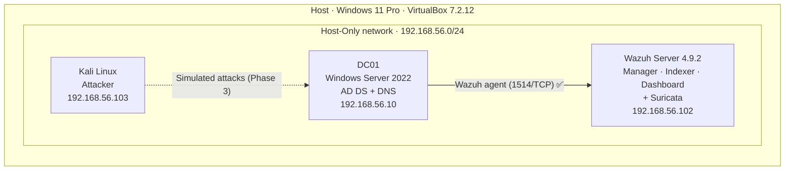

| Component | Details |
|---|---|
| Operating system | Windows Server 2022 Standard Evaluation (Desktop Experience) |
| Resources | 2 vCPU · 4 GB RAM · 60 GB dynamic VDI disk |
| Network | Host-Only `192.168.56.10/24`, DNS pointing to itself |
| Domain | `lab.local` · NetBIOS `LAB` · Windows Server 2016 functional level |
| Roles | Active Directory Domain Services, DNS |
| Monitoring | Wazuh agent 4.9.2 → manager `192.168.56.102` |

---

## ⚙️ Phase 1 — Infrastructure

### 1. Base server configuration

Hostname, static IP and local DNS were set before installing any roles.

```powershell
Rename-Computer -NewName "DC01" -Restart

New-NetIPAddress -InterfaceAlias "Ethernet" -IPAddress 192.168.56.10 -PrefixLength 24
Set-DnsClientServerAddress -InterfaceAlias "Ethernet" -ServerAddresses 127.0.0.1
```

### 2. AD DS installation and promotion to domain controller

```powershell
Install-WindowsFeature AD-Domain-Services -IncludeManagementTools

Install-ADDSForest `
    -DomainName "lab.local" `
    -DomainNetbiosName "LAB" `
    -DomainMode "WinThreshold" `
    -ForestMode "WinThreshold" `
    -InstallDns
```

### 3. Nimbrek S.A. organizational structure

Created with PowerShell so the environment is **reproducible**:

| Type | Items |
|---|---|
| Organizational units | IT (`TI`) · Sales (`Ventas`) · HR (`RRHH`) · Finance (`Finanzas`) · `Servidores` · `Estaciones` |
| Security groups | `GG_TI` · `GG_Ventas` · `GG_RRHH` · `GG_Finanzas` |
| Test users | 7 accounts distributed across departments |

> 🔐 Lab credentials are never published in this repository.

### 4. Validation

```powershell
dcdiag /v
Get-ADDomain | Select-Object DNSRoot, NetBIOSName, DomainMode
Get-ADOrganizationalUnit -Filter * | Select-Object Name
```

`dcdiag` passes every test except **SystemLog**, an expected and harmless failure: the Host-Only network has no internet access, so Windows logs DNS timeouts when trying to reach Microsoft's activation endpoints.

---

## 📡 Phase 2 — Visibility ✅

The Wazuh agent was deployed **offline**: the domain controller has no internet access, so the MSI was downloaded on the host and delivered through a read-only VirtualBox shared folder.

```powershell
Start-Process msiexec.exe -ArgumentList '/i','C:\Temp\wazuh-agent-4.9.2-1.msi','/q',
    'WAZUH_MANAGER=192.168.56.102','WAZUH_AGENT_NAME=DC01',
    'WAZUH_REGISTRATION_SERVER=192.168.56.102' -Wait
Start-Service WazuhSvc
```

Enrollment was verified from the manager:

```text
$ sudo /var/ossec/bin/agent_control -l
   ID: 000, Name: wazuh-server (server), IP: 127.0.0.1, Active/Local
   ID: 004, Name: DC01, IP: any, Active
```

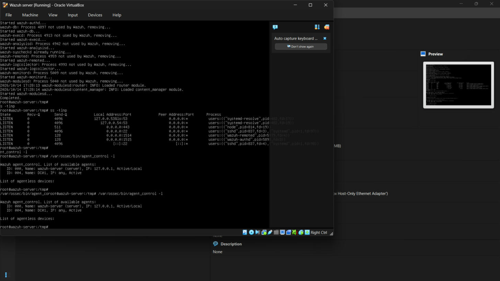
*DC01 agent reporting to the Wazuh manager as `Active`*

**Advanced audit policy** is applied with [`scripts/Enable-AuditPolicies.ps1`](scripts/Enable-AuditPolicies.ps1),
which turns on Success+Failure auditing for the subcategories that feed the
Phase 3 detections (logon, Kerberos AS/TGS, account and group management,
directory service access) and enlarges the Security event log. On a single-DC
lab these are applied locally with `auditpol`; in a multi-DC domain the same
subcategories would be pushed through a GPO linked to the Domain Controllers OU.

**End-to-end validation (done).** Failed authentications generated against the
DC produced event **4625** (logon type 3), which the agent forwarded to the
manager. The events were confirmed directly in `alerts.json`:

```bash
$ grep -c 4625 /var/ossec/logs/alerts/alerts.json
22
```

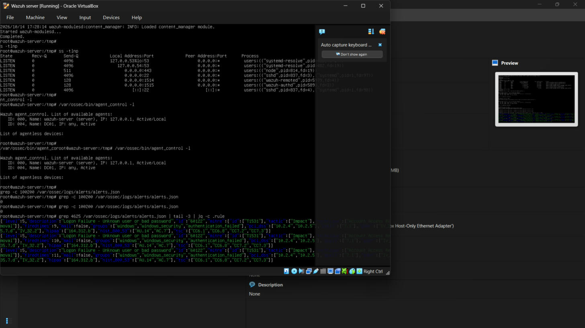
*Event 4625 reaching the SIEM and matched by the built-in Windows ruleset*

With the Windows pipeline confirmed end-to-end, the lab moves into Phase 3.

---

## 🔧 Troubleshooting: what didn't work the first time

Two real incidents happened while building this lab. I'm documenting them because solving them taught me more than anything that worked on the first try.

### Incident 1 — The first domain controller couldn't be saved

| Problem | Diagnosis | Resolution |
|---|---|---|
| Update **KB5122882** hung for hours on "Working on updates" and then rolled back | The host has **Hyper-V/VBS enabled at firmware level**, so VirtualBox runs on top of the Windows hypervisor with much lower disk I/O | Mitigate instead of remove: 2 vCPU, frequent snapshots, *headless* mode |
| `Install-WindowsFeature AD-Domain-Services` failed with **0x800f0827** | Servicing stack left in an inconsistent state by the half-applied update (`CBS_E_STACK_SHUTDOWN_REQUIRED` in `CBS.log`) | Repairing the VM was ruled out |
| The VM froze on reboot | System state not recoverable at a reasonable cost | **Clean rebuild (DC01-v2)**, keeping the original VM as evidence before deleting it |

**Deliberate decision:** Windows Update stays disabled in this isolated, offline lab to ensure stability. In production this would be unacceptable — a domain controller must be kept up to date.

### Incident 2 — The SIEM went silent

After deploying the agent, the DC could not reach the manager on ports 1514/1515.

| Step | Finding |
|---|---|
| Network check from DC01 | ARP resolved the host, but nothing answered at `192.168.56.102` |
| Manager status | `wazuh-manager` **failed**: *"No space left on device"* |
| Disk usage | Root filesystem at **100%**; `/var/ossec/queue/vd_updater/tmp` held **12 GB** of vulnerability-feed temporary files |
| Cleanup | Temporary files removed → disk at **55%** (11 GB free) |
| Second failure | Manager start killed by **systemd timeout** on slow I/O |
| Fix | Drop-in override `TimeoutStartSec=600` for `wazuh-manager.service` → service active, listening on 1514/1515 |

**Lessons learned**

- Knowing when to stop repairing and rebuild from a known-good state is an operational skill. Per-phase snapshots made the rebuild fast and safe.
- "The agent can't connect" is not always a network problem — check the service on the other end first.
- Monitoring the monitoring stack matters: a SIEM with a full disk fails silently.

### Incident 3 — The agent that would not connect

Before the first detection, the DC agent sat at **"Never connected"** for hours
even though enrollment had succeeded. The fix only came after ruling causes out
in order:

| Hypothesis | Check | Verdict |
|---|---|---|
| Key mismatch between agent and manager | Compared `client.keys` on both sides | Identical — not the cause |
| Clock skew breaking message validation | `timedatectl` on the manager | Real (manager was ~15 h behind); fixed, but not the cause |
| Manager not listening | `ss -tlnp` → `wazuh-remoted` on `0.0.0.0:1514` | Listening — not the cause |
| **Stale daemon holding the port** | A failed restart left an **old `wazuh-remoted` process bound to 1514** (`Address already in use`) | **Root cause** |

The agent had been talking to a **zombie `remoted`** that still held port 1514
but no longer had the current keys, so every connection was silently dropped.
Killing the stale processes (`pkill -9 -f /var/ossec`) and starting the manager
clean fixed it immediately — the agent registered as `Active` within seconds.

**Lessons learned**

- "Never connected" is rarely one thing. Rule causes out methodically.
- A zombie process can impersonate a healthy service. Always confirm **which PID
  owns the port**, not just that *something* is listening.
- On a slow single-vCPU VM, `systemctl restart` can start the new daemon before
  the old one released its socket. A clean `stop → kill stragglers → start` is
  more reliable than a plain restart.

---

## 📸 Evidence

| | |
|---|---|
| 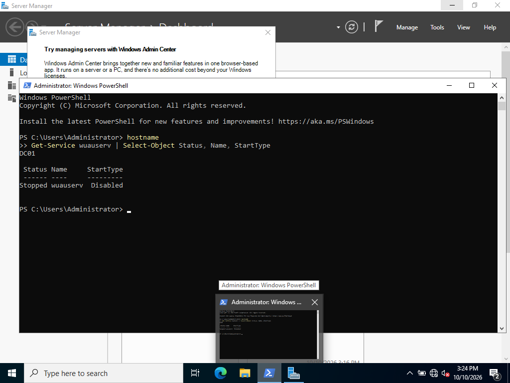 | 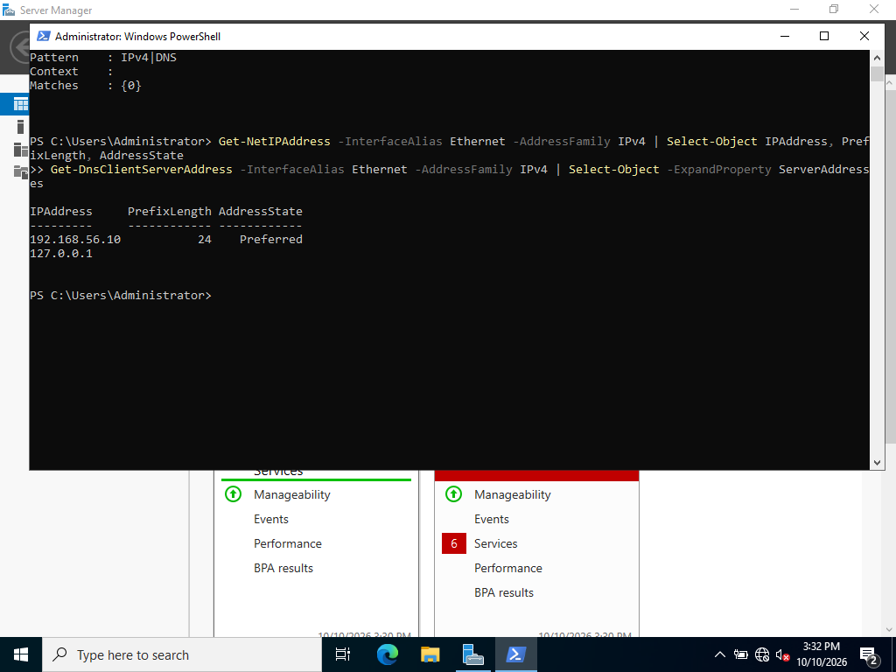 |
| *DC01 hostname and Windows Update disabled* | *Static IP and local DNS* |
| 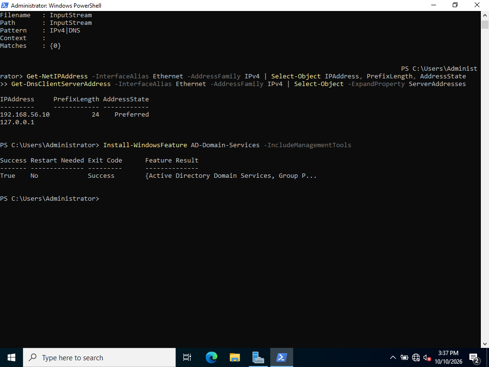 | 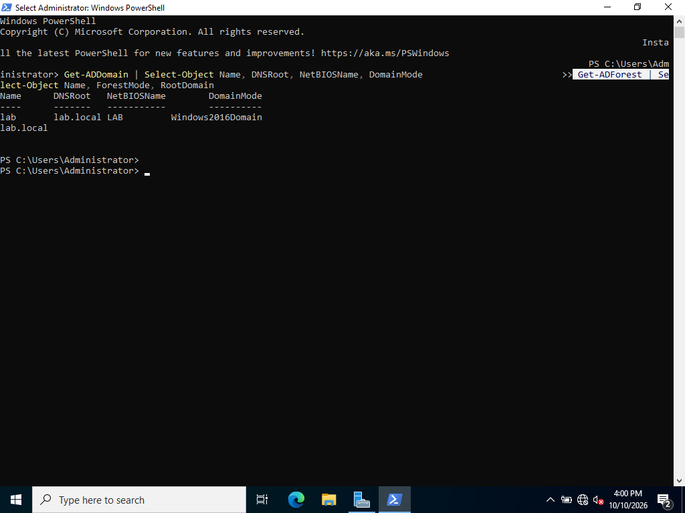 |
| *AD DS role installed* | *Forest `lab.local` created* |
| 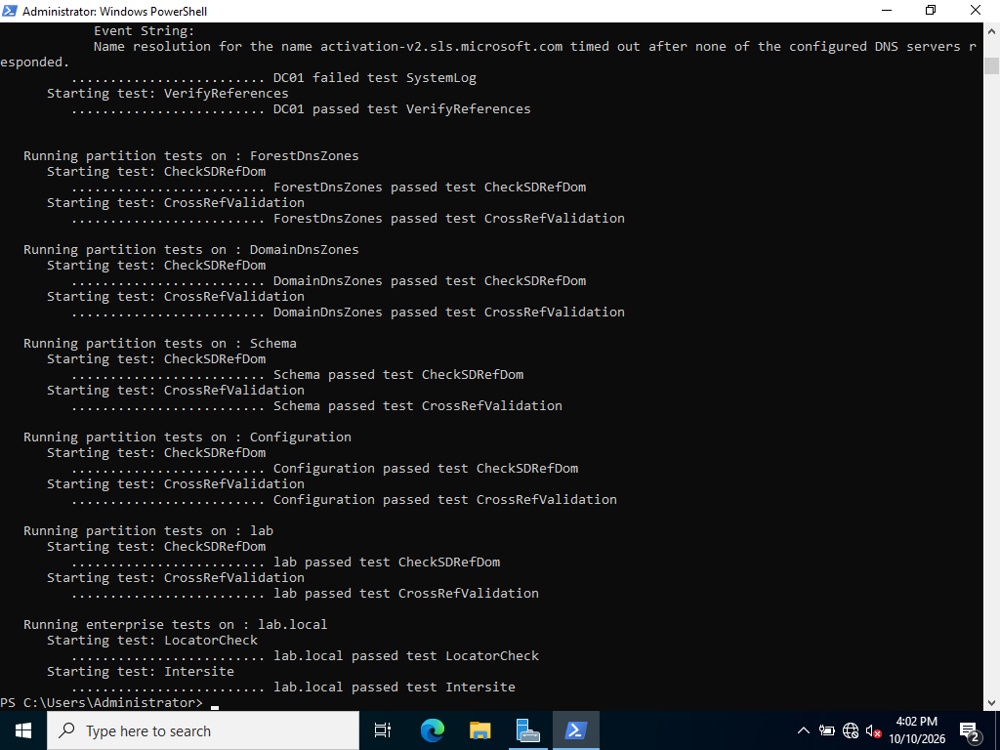 | 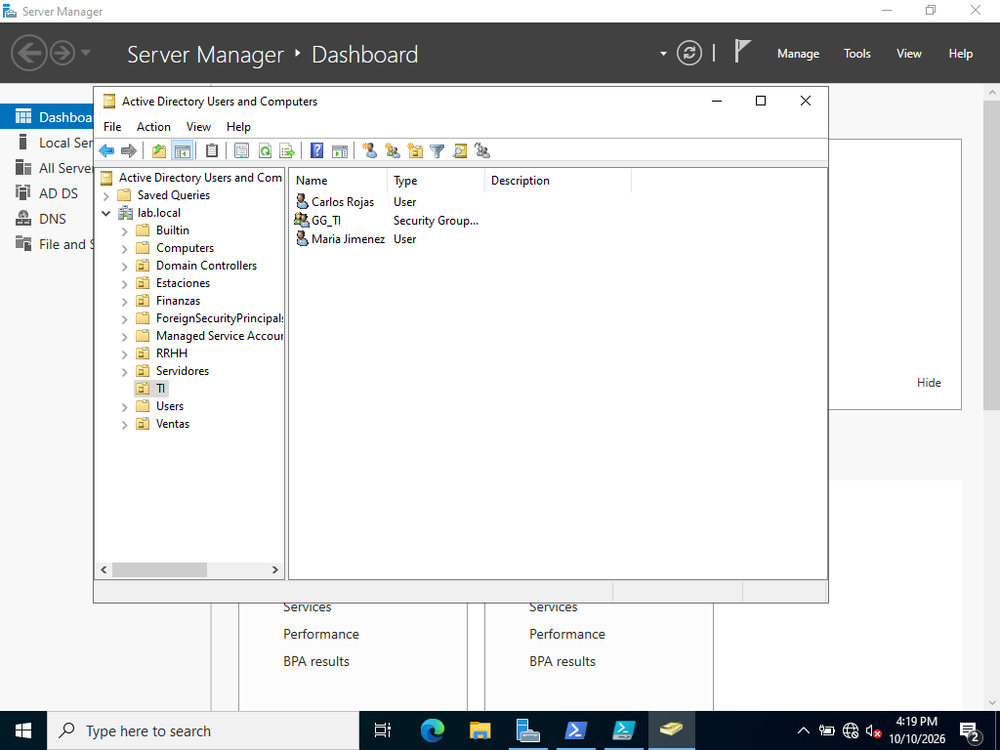 |
| *`dcdiag` validation* | *Nimbrek S.A. OUs, groups and users* |

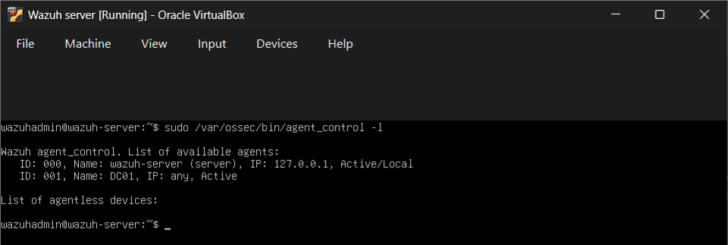
*DC01 enrolled and active in the Wazuh manager*

<details>
<summary>🔧 Troubleshooting evidence</summary>

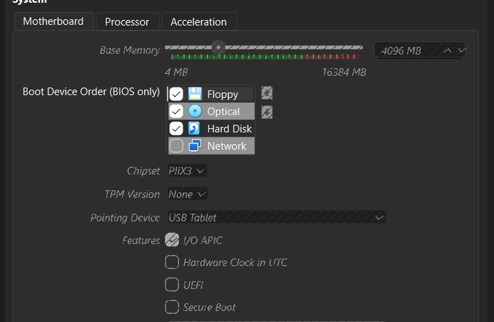
*Original VM configuration*

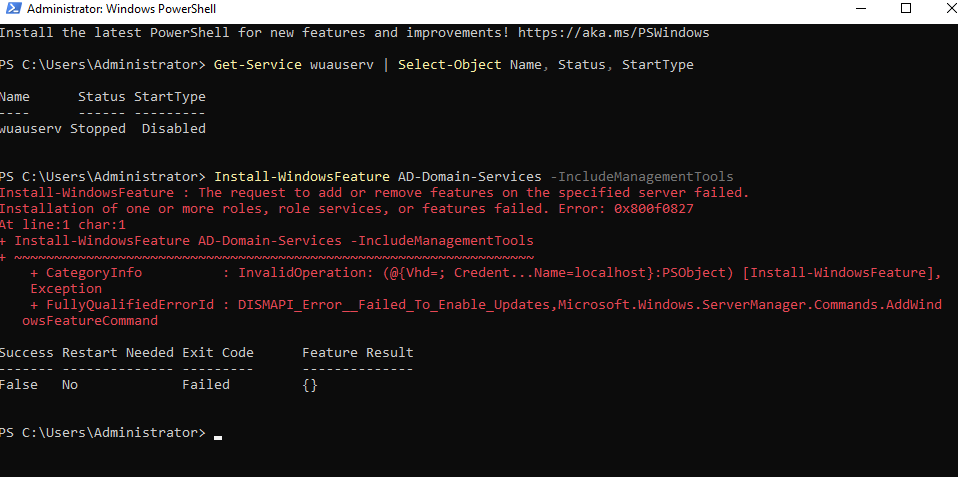
*AD DS installation failing with 0x800f0827*

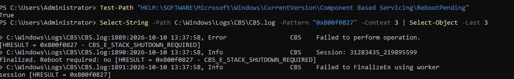
*Root cause in `CBS.log`: `CBS_E_STACK_SHUTDOWN_REQUIRED`*

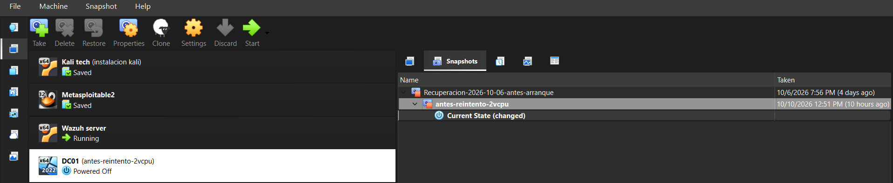
*Recovery attempts on the original VM*

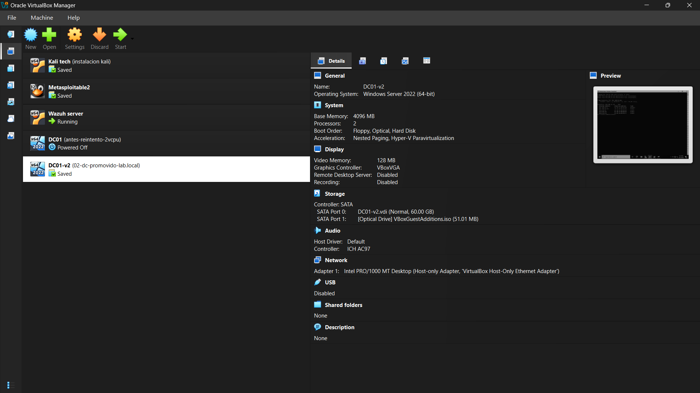
*Original VM powered off, DC01-v2 in service*

</details>

---

## 🚀 Phase 3 — Attack & detection (in progress)

| Technique | MITRE ATT&CK | Key Windows event | Status |
|---|---|---|---|
| Brute force | T1110.001 | 4625 | ✅ detected live |
| Password spraying | T1110.003 | 4625 / 4771 | ✅ detected live |
| Kerberoasting | T1558.003 | 4769 (RC4 encryption `0x17`) | ✅ detected live · single honeytoken request now level 12 (100212, pending validation) |
| Domain account discovery | T1087.002 | 4662 (decoy object with a read SACL) | 🟡 rule written (100230), pending live validation |
| Privileged group changes | T1098 | 4728 / 4732 / 4756 | ✅ detected live |

Full technique-by-technique breakdown with detection logic and evidence:
[`docs/mitre_attack_mapping.md`](docs/mitre_attack_mapping.md).

### First live detection — Brute force (T1110.001)

Ten failed SMB authentications were generated from the DC against itself
(`net use \\192.168.56.10\ipc$` with wrong credentials). Each produced event
4625; the agent forwarded them; the manager correlated them and raised a
**brute-force alert mapped to MITRE ATT&CK T1110**, captured in `alerts.json`.

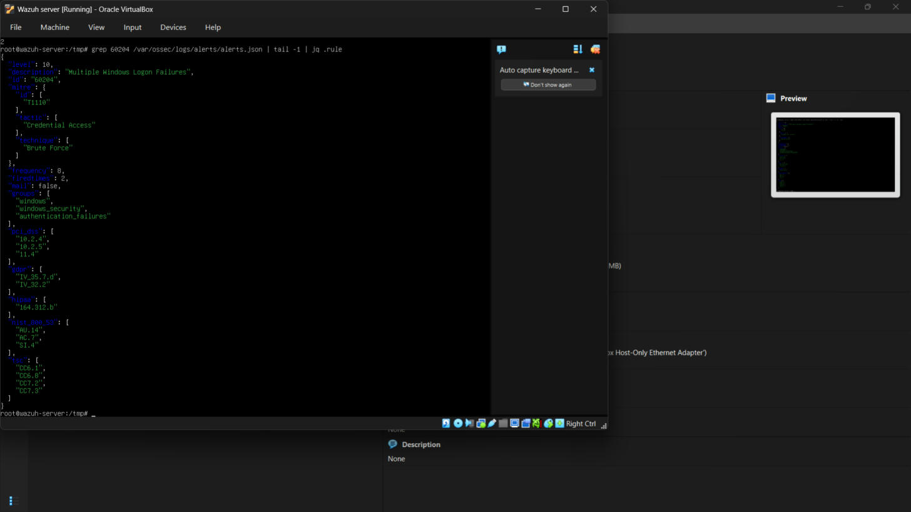
*Alert 60204 "Multiple Windows Logon Failures" → T1110 (Credential Access / Brute Force)*

Deliverables:

- [x] Advanced audit policy script ([`scripts/Enable-AuditPolicies.ps1`](scripts/Enable-AuditPolicies.ps1))
- [x] Custom Wazuh rules for brute force, password spraying (NTLM and Kerberos), Kerberoasting and privileged group changes ([`rules/local_rules.xml`](rules/local_rules.xml)), aligned with the Wazuh 4.9.2 ruleset
- [x] End-to-end validation: brute force (T1110.001) fired by a real attack, alert captured from `alerts.json`
- [x] End-to-end validation: password spraying (100201), Kerberoasting (100210) and privileged-group changes (100220) each fired by a real attack and captured in `alerts.json`
- [x] Honeytoken service account (`svc_sql_backup`, RC4-only SPN `MSSQLSvc/db01.lab.local:1433`) used to trigger the Kerberoasting detection
- [x] Incident report per attack (timeline, IOCs, response, hardening) — [`docs/incident-reports.md`](docs/incident-reports.md)
- [x] Discovery decoy: disabled account `adm_backup_legacy` with a Read-Property SACL ([`scripts/Setup-DiscoveryDecoy.ps1`](scripts/Setup-DiscoveryDecoy.ps1)) + rule 100230
- [ ] End-to-end validation of 100230 (LDAP enumeration from Kali) and 100212

---

## 🤖 Phase 4 — AI-assisted triage (in progress)

This phase evolves the [Home SOC Lab AI pipeline](https://github.com/ddiazcr/home-soc-lab/tree/main/AI) into a triage assistant for Active Directory alerts. The design goal is an assistant the analyst controls, not an autonomous responder.

```
Wazuh alert (level ≥ 10)
   → Wazuh custom integration (Python)
   → Claude API: schema-validated JSON
        { verdict, confidence, mitre_id, summary, suggested_action }
   → Telegram/Discord card with [Approve] [False positive]
   → analyst decision logged; nothing executes without approval
```

Design decisions:

| Decision | Why |
|---|---|
| **Only alerts go to the model, never raw logs** | The SIEM filters and correlates; the model assists on dozens of alerts a day, not thousands of events per second. Keeps cost and latency realistic. |
| **Structured output validated against a schema** | Free text cannot be measured or automated safely. Invalid JSON is rejected and the alert falls back to normal handling. |
| **The model suggests, the analyst decides** | Log fields (usernames, command lines) are attacker-controlled, so model output is untrusted input. Containment of a domain controller would break authentication for the whole company and is never automated. |
| **Prompt-injection defenses** | Alert data is passed as delimited data, never as instructions; the allowed `suggested_action` values are a fixed list; the model has no credentials and no tools that change the environment. |
| **Single model call before multi-agent** | Multiple agents multiply cost and failure points. The pipeline will be split only if measurements show a need. |
| **Prompt caching for static context** | The static instructions are marked for caching. In the first measured run the prompt was still below the model's minimum cacheable length, so no discount applied yet; it will matter once playbooks and MITRE context are added. |

Deliverables:

- [x] Triage of level ≥ 10 alerts (currently fed from a file of the validated Phase 3 alerts)
- [ ] Live Wazuh custom integration feeding alerts as they fire
- [x] JSON schema for the triage verdict, with validation and fallback
- [x] Human-approval gate with decision log + Telegram notification
- [x] Prompt-injection test cases using malicious values in log fields — both flagged, kept at critical
- [x] Latency and cost per alert (~4 s, ~$0.003 with Claude Haiku 4.5)
- [ ] Accuracy against the validated attacks and false-positive rate over a larger alert set
- [ ] Remediation scripts generated by the model for human review, never auto-executed

---

## 🛡️ Phase 5 — Hardening (in progress)

Measure, harden, measure again, then re-run the Phase 3 attacks to see what
changed — including what the detections stop seeing.

1. `Invoke-ADAudit.ps1 -Label before` — read-only, 14 checks (lockout, password length, RC4 on SPN accounts, AS-REP roasting, krbtgt age, Domain Admins size, Protected Users, Guest, MachineAccountQuota, NTLMv1, LDAP signing, SMB signing, Print Spooler), each mapped to the technique it mitigates; saves JSON.
2. `Invoke-ADHardening.ps1` — dry run by default; `-Apply` to change. Domain Admins membership, Protected Users and the krbtgt reset are reported only, never automated.
3. `Invoke-ADAudit.ps1 -Label after` and repeat the attacks from Kali.

Design exception: the honeytoken `svc_sql_backup` keeps RC4 on purpose — it is the bait that makes Kerberoasting visible.

---

## 🔭 Future projects

Kept out of this lab on purpose, to keep it focused and within the resources of a single laptop:

- **Lightweight SOAR with case management** — TheHive (and MISP for threat intelligence) receiving alerts, with human-approved response actions.
- **AI-assisted detection engineering** — generating Sigma rules with Claude and validating each one against real attacks before accepting it.

---

## 🧰 Tech stack

`Windows Server 2022` · `Active Directory` · `DNS` · `PowerShell` · `Group Policy` · `Wazuh` · `Suricata` · `Kali Linux` · `VirtualBox` · `MITRE ATT&CK` · `Python` · `Claude API`

---

## 👤 Author

**Daniel Díaz** — Advanced Cybersecurity Technician focused on Blue Team / SOC · Costa Rica
[LinkedIn](https://linkedin.com/in/danieldiazcr) · [GitHub](https://github.com/ddiazcr)

*This project is for educational purposes only, built entirely within an isolated home lab environment.*
